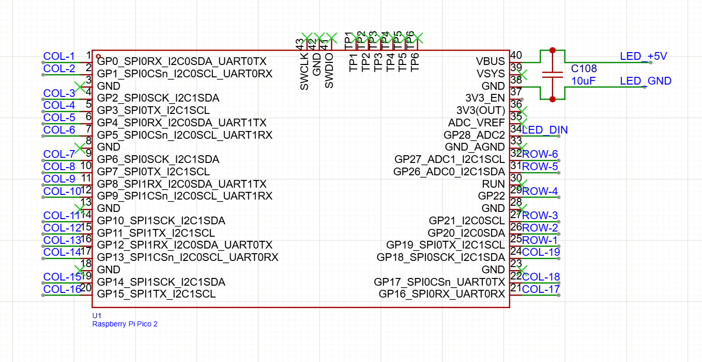
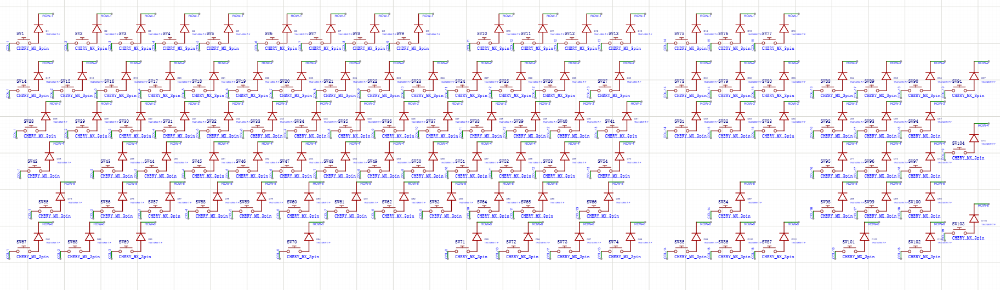
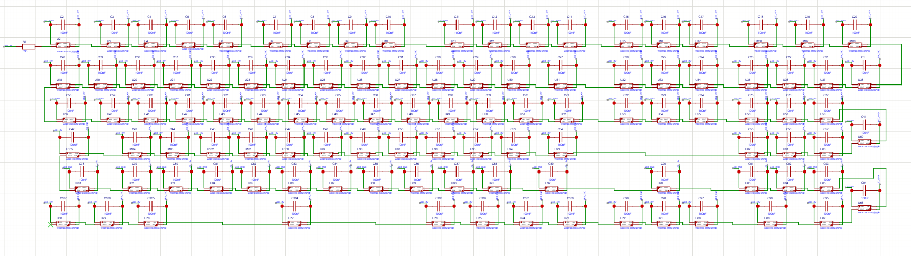
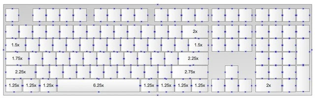
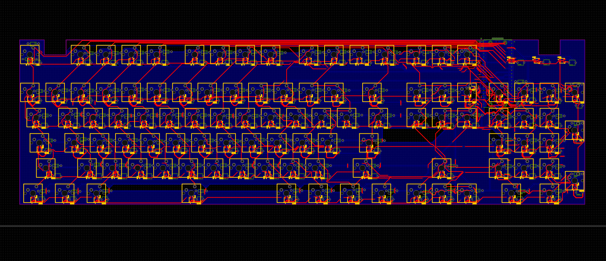
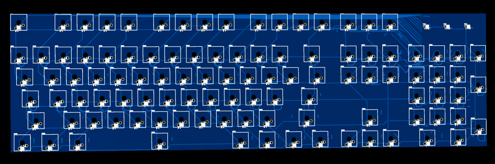

# RGB-Keyboard
A keyboard that lights up in any color. The colors can also have effects, like a rainbow across the entire keyboard or a wave from the key pressed.

I made this so I could have an RGB keyboard that I can use for typing code and so it looked cool.

## Schematic
The schematic is in 3 pages, the Raspberry Pi Pico,  the switches, the LEDs.

Page 1:

Page 2:

Page 3:

## PCB
 I used an image of a layout I found to base the switch distances off of.

Layout:

PCB:

## 3d Render

The Onshape link to this project is [here](https://cad.onshape.com/documents/bef98f37e404cedfbf342dc0/w/166404571d869c1e016b182f/e/b0c13dd24791b61a15dc45c6).

3d:

Assembly with switches and keycaps:

## Reviewer Note(s)

I will purchase the keycaps and stabilizers for my project along with Week 2, in which I am making the [enclosure for my keyboard](https://github.com/araschke001-commits/RGB-Keyboard-Enclosure), along with the plate for it.

In the PCB assembly on Onshape, the switches I have in the assembly are not the switches I am using for my project, but are close (the main difference is in the hole for the LED's). Instead, I am using [these](https://www.aliexpress.us/item/3256802192387196.html). Also the keycaps should have the correct dimensions, but also I am buying them elsewhere (for week 2).

I had to switch from using SMD components with PCBA for the capacitors, diodes, and resistor to using through hole ones to save on cost. The cost had increased because of a $30 coupon on JLCPCB expiring, extra costs for customs on JLCPCB, and Global Standard Direct Line not being available for shipping due to the weight of the PCB. I also am no longer able to use PCBA because of this, and even just the PCB still makes it go right up to the price limit. I also had to find the through hole components on AliExpress and change which Raspberry Pi Pico 2 board I was using to save on price, which are these:
- 1x [Raspberry Pi Pico 2 RP2350 USB-C](https://www.aliexpress.com/item/3256812882649936.html) ($3.97)
- 2x [100pcs 1N4148 DO-35 Diode](https://www.aliexpress.com/item/3256804920500448.html) ($1.63)
- 1x [100pcs 330R 1/4W Resistor](https://www.aliexpress.us/item/3256806565404055.html) ($1.14)
- 1x [200pcs 100nF 10% Monolithic Capacitor](https://www.aliexpress.com/item/3256808311121039.html) ($2.74)
- 1x [50pcs 10uF Monolithic Capacitor](https://www.aliexpress.com/item/3256807481050401.html) ($0.90)